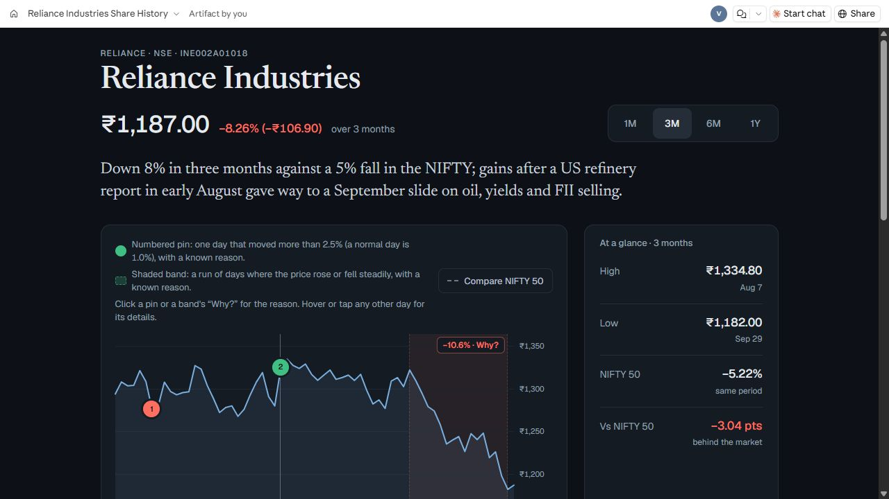
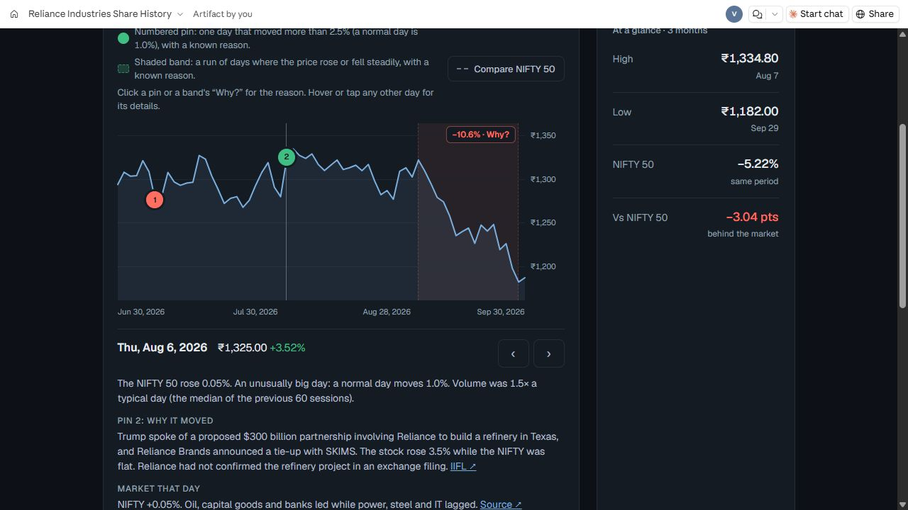
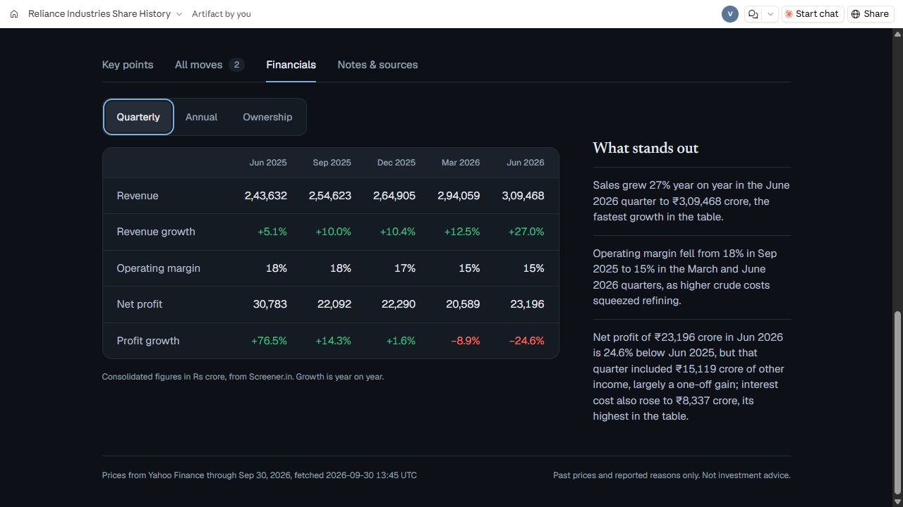
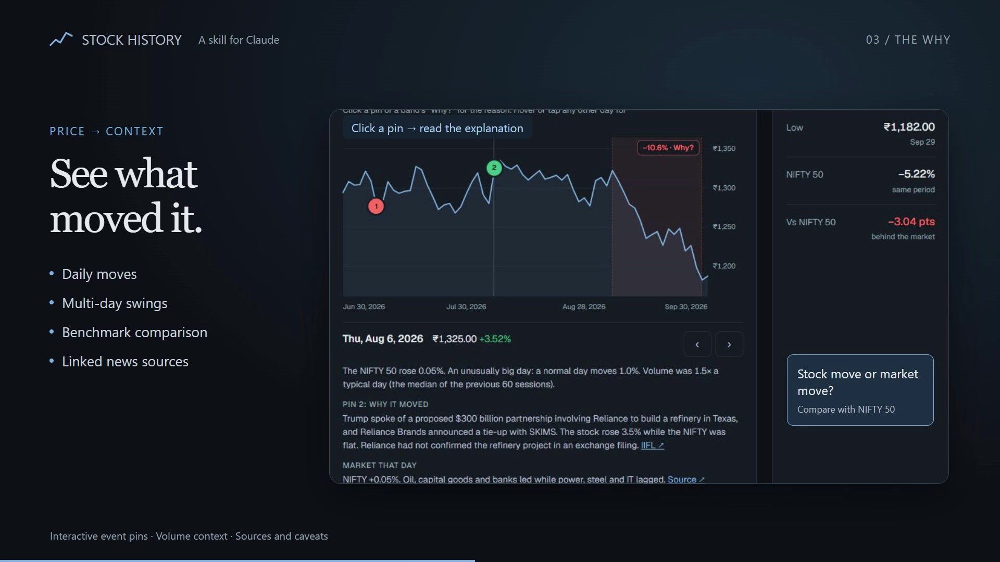

<div align="center">

# Stock History — Claude Skill for Stock Market Research

### The price tells you what happened. The research explains why.

An open-source **Claude skill for stock analysis** across **Indian NSE/BSE and US markets**. Explore stock price history, understand major price moves, compare market benchmarks, and build interactive research reports with linked news, financials, and exchange filings.

**NSE / BSE / US** · **Interactive reports** · **Python standard library** · **MIT licensed**

[Live Reliance report](https://claude.ai/artifact/JBhbUXhdqYytrnU86iHLPV) · [Watch the 20-second demo](docs/demo/stock-history-demo.mp4) · [Install](#installation) · [Example prompts](#stock-analysis-example-prompts)

</div>

---



Ask about a stock, share a watchlist, or upload a broker screenshot. Stock History resolves the company, compares its price moves with the market, and researches the news and filings behind the changes. The result is an interactive report with the chart and its evidence together.

## Interactive stock charts with news-backed explanations



**Click a move. Read the reason. Follow the source.** Numbered pins explain researched single-day moves; shaded bands explain sustained rallies and declines. Days with no established catalyst remain accessible, with the uncertainty stated plainly.

| Capability | What it adds |
| :--- | :--- |
| **Multiple time windows** | Explore 1M, 3M, 6M, and 1Y where sufficient history exists. |
| **Market context** | Compare the stock with its benchmark to distinguish broad moves from company-specific events. |
| **Daily details** | Inspect price changes, volume, filings, and researched news for individual sessions. |
| **Financial context** | Review quarterly results, annual financials, and ownership alongside plain-language observations. |
| **Portfolio reports** | Browse multiple companies in one searchable report. |
| **Visible evidence** | Open dated sources and see where the research could not establish a cause. |

<details>
<summary><strong>Preview financials and research notes</strong></summary>



Financial tables sit beside observations that explain the numbers. Missing sections are omitted rather than filled with estimates.

</details>

<sub>Screenshots are from the supplied Reliance report, captured on 30 September 2026. They illustrate the output and are not live quotes or independently verified market research. [Open the interactive example](https://claude.ai/artifact/JBhbUXhdqYytrnU86iHLPV).</sub>

## Installation

### Claude.ai / Claude app

1. Download this repository with **Code → Download ZIP** and extract it.
2. Open a terminal in the extracted repository and build the skill upload ZIP:

   ```sh
   python tools/package_skill.py
   ```

3. Enable **Code execution and file creation** in Claude. Open the Skills section, upload **`dist/stock-history.zip`**, and enable Stock History.

The generated ZIP contains the skill folder directly at its root. Upload that file; GitHub’s repository ZIP includes extra repository files.

See Claude’s official [installation guide](https://support.claude.com/en/articles/12512180-use-skills-in-claude) and [packaging guide](https://support.claude.com/en/articles/12512198-how-to-create-custom-skills) for current account requirements and interface details.

### Claude Code

Copy the `stock-history/` folder into `~/.claude/skills/` for personal use or `.claude/skills/` inside a project. The instructions resolve bundled resources relative to `SKILL.md`, supporting local and cloud installation paths.

## Stock analysis example prompts

Start with a company name, ticker, watchlist, or holdings screenshot. These prompts work as starting points after installing the skill:

> Explain Reliance's stock price history over the last three months. Compare it with the NIFTY 50 and research the biggest moves.

> What happened to Suzlon over the last three months? Explain the biggest moves.

> Why did Apple fall? Compare its down days with the S&P 500 and check the filings.

> Build one report for the stocks in this holdings screenshot.

Reports can be delivered as HTML files or published through a supported tool when the user authorizes the destination. Installing this skill does not create a hosted website.

## How it works

**Resolve → Fetch → Compare → Research → Report**

The skill resolves the ticker, retrieves prices and financials, compares unusual moves with the benchmark, checks dated news and exchange filings, and builds the report. Prices come from fetched data; causal explanations require supporting evidence. If a cause cannot be established, the report records the gap.

| Data | Main source |
| :--- | :--- |
| Prices and benchmarks | Yahoo Finance |
| Indian financials and ownership | Screener.in |
| Indian announcements and bulk/block deals | NSE |
| US financials and filings | SEC EDGAR |
| US ownership and fallback financials | Yahoo Finance |

**Requirements:** Python 3, outbound network access, and an agent with search or browsing for news research. The helpers require no third-party Python packages. For US filings, configure your own contact email through the `SEC_CONTACT` environment variable; keep it outside the repository.

Public endpoints can change, reject requests, or return incomplete data. The current report embeds its chart logic and data and loads fonts from Google Fonts; the older optional builder also loads Chart.js from a CDN.

## Watch the prompt-to-report demo

[](docs/demo/stock-history-demo.mp4)

**[Watch the 20-second video](docs/demo/stock-history-demo.mp4)** — from one prompt to price history, major-move explanations, financials, and portfolio features. This is an edited walkthrough; report generation time depends on the research and data sources.

## Frequently asked questions

### What is Stock History?

Stock History is a reusable Claude skill for evidence-backed equity research. It combines Python data helpers with a research workflow and an interactive HTML report. Use it to understand past stock performance and the reported events behind unusual moves.

### Does it support Indian and US stocks?

Yes. The workflow covers listed Indian companies on the NSE and BSE and US-listed stocks. Financials, ownership, filings, and historical coverage depend on the company and source availability.

### Can it explain why a stock fell or jumped?

It identifies unusual sessions and sustained swings, compares them with the market, and researches dated news and filings. Explanations link to evidence; when a catalyst cannot be established, the report says so.

### Can I analyze a portfolio or broker screenshot?

Yes. Provide a watchlist or holdings screenshot to identify the companies and build a searchable multi-stock report. Keep personal account information out of public issues and contributions.

### Is it a live trading tool or stock prediction service?

No. It focuses on historical prices, financial context, and sourced research. It does not place trades, predict returns, or provide investment recommendations. Data may be delayed or incomplete.

### Is Stock History free and open source?

The repository is MIT licensed. Using it still requires a compatible Claude environment, Python 3, network access, and browsing or search for news research. Account and data-provider restrictions may apply.

## Feedback and contributions

Found a data-source issue or have a report improvement? [Open an issue](https://github.com/gaurvedant25/stock-history/issues) with the public ticker, relevant dates, and steps to reproduce it. If the skill helps your research, a GitHub star is a useful way to bookmark it and support the project.

<details>
<summary><strong>Repository structure and development</strong></summary>

```text
stock-history/
├── SKILL.md                  Research workflow and agent instructions
├── references/               Sources, fallbacks, and swing research
└── scripts/                  Data fetchers and report builders
tools/
└── package_skill.py          Reproducible Claude upload ZIP
docs/images/                  Screenshots used in this README
LICENSE                       MIT license
```

After making changes:

```sh
python -m compileall -q stock-history/scripts tools
python tools/package_skill.py
```

`build_portfolio.py` and `portfolio_template.html` provide the current report design. `build_report.py` is the older optional builder; `render_chart.py` provides an SVG fallback.

The upload ZIP contains the instructions, references, and scripts. Repository screenshots, generated portfolios, caches, local reports, and environment files stay outside it. Do not commit personal holdings screenshots or research output. A successful package build does not verify live provider access or research accuracy.

</details>

---

**Past prices. Reported causes. No investment recommendations.** Data may be delayed or incomplete, and a nearby headline alone does not establish causation.

MIT © 2026 Vedant Gaur · [License](LICENSE)
